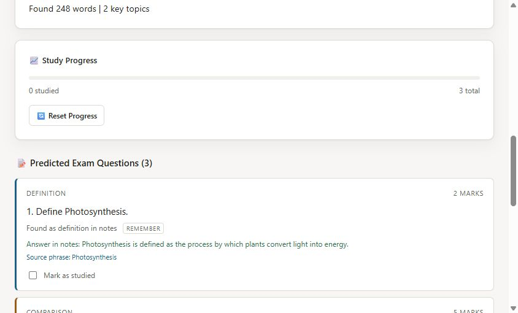

# Exam Reminder

 [](LICENSE)



Upload class notes and get practice questions plus a revision schedule. The local path runs without an API key.

## Run it

```bash
pip install -r requirements.txt
python app.py
```

Open `index.html` in a browser. The page posts to `http://127.0.0.1:8000/analyze`. The API also exposes `GET /` as a health check.

## What it does

- Extracts text from an uploaded PDF, image, or text file in `ocr_service.py`. PDFs use pdfplumber. Images use Tesseract OCR.
- Finds definitions, comparisons, numbered lists, formulas, bold terms, and the most repeated topics.
- Builds questions locally from those findings, with difficulty and marks attached.
- If an exam date is supplied, builds a revision schedule of up to 14 days.

The question generator in `app.py` is rule based. No API key is needed and nothing leaves your machine.

## API example

```bash
curl -F "file=@notes.pdf" -F "subject=History" -F "exam_date=2026-12-10" http://127.0.0.1:8000/analyze
```

## Verify it

```bash
curl http://127.0.0.1:8000/
```

The response includes `"status": "ok"`.

## Limits

- Image input needs the Tesseract binary installed on the machine, not just the Python package.
- Files with no readable text return a 400 with a clear message instead of empty results.
- CORS allows local file pages and `127.0.0.1:8000` or `localhost:8000`. Set `EXAM_ALLOWED_ORIGINS` to a comma separated list to serve a hosted UI.
- The page uses your current origin when served over HTTP, but the browser needs an allowed origin, so a remote host must be added to that list.
- Question quality follows the structure of your notes. Scanned handwriting needs a good OCR pass first. Treat questions as drafts and check each one against the source shown under it.
- Copy questions and Print or save as PDF are available after generation. Printing uses a plain black and white stylesheet with no controls or dark background.
- The page has Paper, Ink and Slate themes.

## License

MIT. See [LICENSE](LICENSE).
